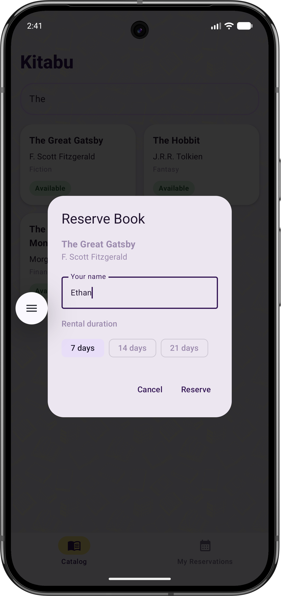
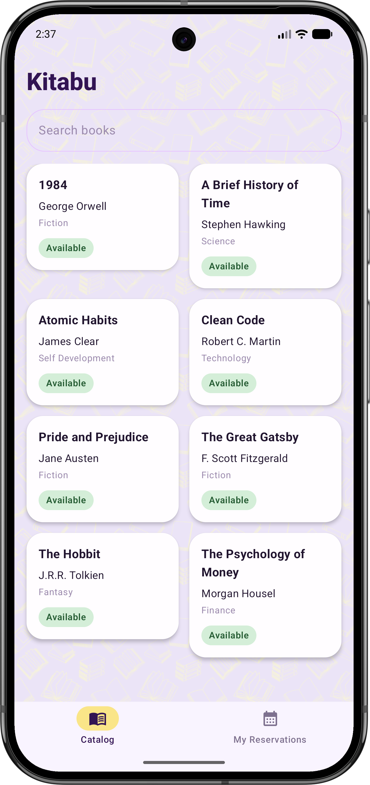
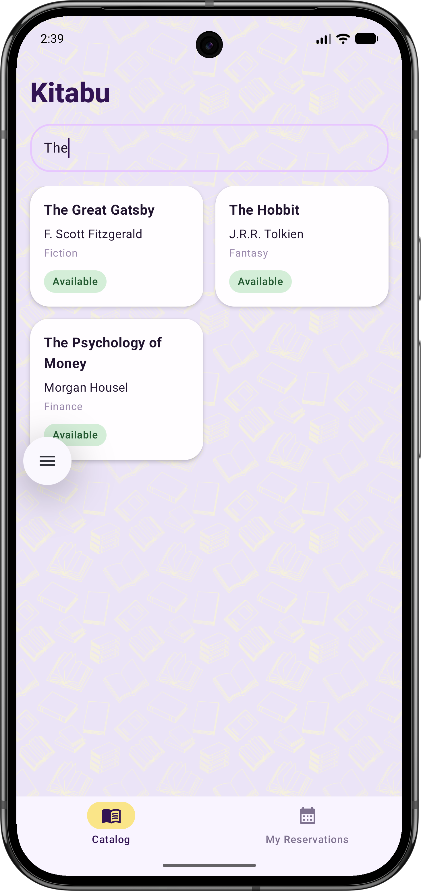
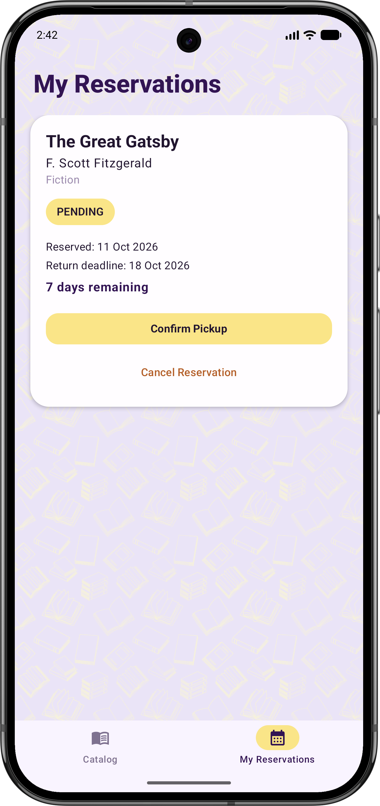
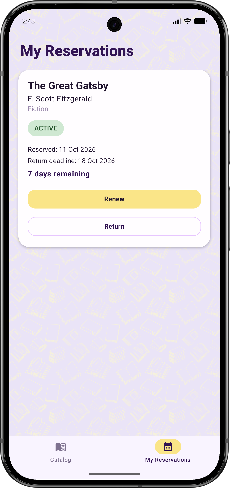
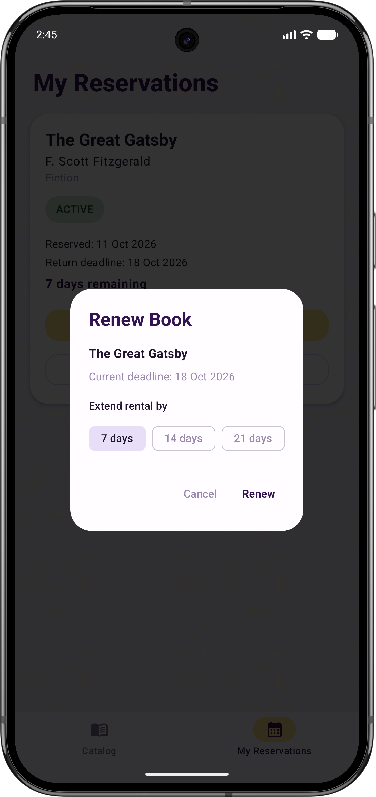
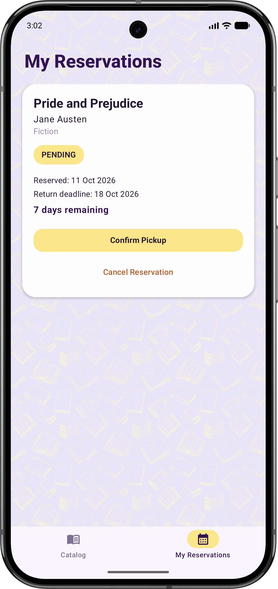
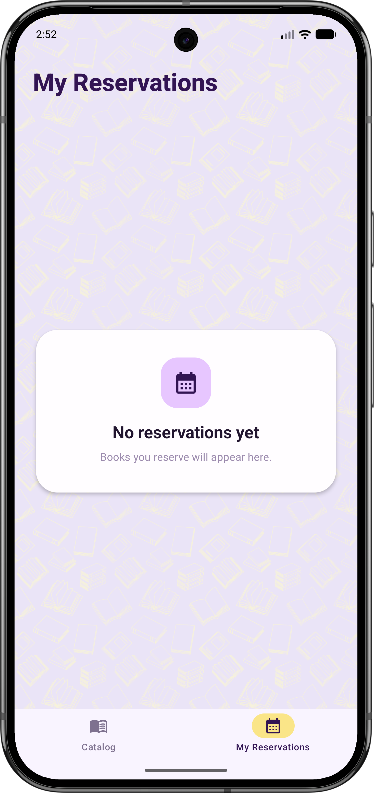

# Kitabu

Kitabu is a native Android Library Book Rental and Reservation application developed for MADB372 – Mobile Application Development B.

The application allows users to browse a local book catalogue, search for books, reserve available titles, manage reservation lifecycles, track return deadlines, renew active rentals, return books, and cancel pending reservations.

## Features

- Browse available and borrowed books
- Search books by title or author
- Reserve available books
- Select a 7, 14, or 21-day rental period
- View reservation dates and return deadlines
- View calculated days remaining
- View due-today and overdue information
- Confirm book pickup
- Renew active rentals
- Return rented books
- Cancel pending reservations
- Automatically update book availability
- Store application data locally using Room
- Reactively update the interface when database data changes

## CRUD Screenshots and Demonstration

The screenshots below demonstrate the main booking lifecycle and the empty reservations state.

### Create - Reserve Dialog

This demonstrates the creation of a new reservation for an available book.



### Read - Catalog and Search

This demonstrates browsing the book catalogue and filtering books by title or author.





### Read - Reservations Dashboard

This demonstrates viewing current reservations together with booking dates, return deadlines, status, and days remaining.



### Update - Confirm Pickup

This demonstrates changing a reservation from `PENDING` to `ACTIVE`.



### Update - Renew Rental

This demonstrates extending the return deadline of an active rental.



### Update - Return Book

This demonstrates returning an active rental and making the book available again.


### Delete - Cancel Reservation

This demonstrates cancelling a pending reservation before pickup.



### Empty Reservations State

This demonstrates the dashboard when there are no current reservations.



## Technology Stack

| Technology | Purpose |
| --- | --- |
| Kotlin | Application logic |
| Jetpack Compose | Declarative user interface |
| Material 3 | UI components and styling |
| Room Database | Local SQLite persistence |
| KSP | Room annotation processing |
| Kotlin Coroutines | Asynchronous database operations |
| Flow / StateFlow | Reactive state management |
| Navigation Compose | Single-activity navigation |
| MVVM | Architecture pattern |

## Architecture Overview

Kitabu follows the MVVM architecture pattern to separate the user interface, application state, business logic, and database operations.

```text
Compose UI
    ↓
ViewModel
    ↓
Repository
    ↓
DAO
    ↓
Room Database
```

Database changes flow back through Room `Flow`, are converted to `StateFlow` in the ViewModels, and are observed by the Compose screens using `collectAsStateWithLifecycle()`.

### UI Layer

The UI layer is built using Jetpack Compose and Material 3. It displays application state and sends user actions to the ViewModels.

### ViewModel Layer

The ViewModels manage screen state, validation, reservation actions, and booking lifecycle operations.

Room Flows are converted to StateFlow using `stateIn()` with `SharingStarted.WhileSubscribed(5000)`.

### Repository Layer

`LibraryRepository` provides an abstraction between the ViewModels and the Room DAOs.

### Data Layer

The data layer contains:

- Room entities
- DAOs
- Database class
- Type converters
- Joined booking data models

### Dependency Injection

Kitabu uses manual dependency injection.

`KitabuApplication` creates an `AppContainer`, which provides the Room database and `LibraryRepository` to the application.

### State Hoisting

The main Compose screens collect state from their ViewModels and pass values and event callbacks to their content composables.

This keeps the screen content separate from application state management.

## Project Structure

```text
com.example.kitabu_madb372_sf1
│
├── data
│   ├── local
│   │   ├── AppDatabase.kt
│   │   ├── BookDao.kt
│   │   ├── BookEntity.kt
│   │   ├── BookingDao.kt
│   │   ├── BookingEntity.kt
│   │   ├── BookingStatus.kt
│   │   ├── BookingWithBook.kt
│   │   └── Converters.kt
│   │
│   └── repository
│       └── LibraryRepository.kt
│
├── di
│   ├── AppContainer.kt
│   └── KitabuApplication.kt
│
├── domain
│   └── RentalValidator.kt
│
├── ui
│   ├── navigation
│   │   └── AppNavigation.kt
│   │
│   ├── screens
│   │   ├── CatalogScreen.kt
│   │   └── DashboardScreen.kt
│   │
│   ├── theme
│   │   ├── Color.kt
│   │   ├── Theme.kt
│   │   └── Type.kt
│   │
│   └── viewmodel
│       ├── CatalogViewModel.kt
│       ├── DashboardViewModel.kt
│       └── ViewModelFactory.kt
│
└── MainActivity.kt
```

## Database Design

Kitabu uses a local Room database containing two related entities.

### BookEntity

| Field | Type | Description |
| --- | --- | --- |
| bookId | Int | Auto-generated primary key |
| title | String | Book title |
| author | String | Book author |
| category | String | Book category |
| isAvailable | Boolean | Indicates whether the book can currently be reserved |

### BookingEntity

| Field | Type | Description |
| --- | --- | --- |
| bookingId | Int | Auto-generated primary key |
| bookOwnerId | Int | Foreign key referencing `BookEntity.bookId` |
| userName | String | Name entered when reserving |
| bookingDate | Long | Reservation timestamp |
| returnDeadline | Long | Return deadline timestamp |
| status | BookingStatus | Current booking status |

`BookingEntity.bookOwnerId` references `BookEntity.bookId` using a foreign key with `CASCADE` delete.

The database is version 1 and is pre-populated with sample book records when it is first created.

## Booking Status Converter

Room stores the booking status using a TypeConverter.

The application supports three booking statuses:

- `PENDING`
- `ACTIVE`
- `RETURNED`

The converter changes the enum value into a String for storage and converts the stored String back into `BookingStatus`.

## Booking Lifecycle

A newly created reservation starts with the `PENDING` status.

```text
Reserve
   ↓
PENDING
   ↓
Confirm Pickup
   ↓
ACTIVE
   ↓
Return
   ↓
RETURNED
```

### PENDING

A newly reserved book is marked as unavailable and the reservation is given the `PENDING` status.

A pending reservation can:

- Be confirmed for pickup
- Be cancelled before pickup

Cancelling the reservation removes the pending booking and makes the book available again.

### ACTIVE

Confirm Pickup changes the reservation from `PENDING` to `ACTIVE`.

An active rental can:

- Be renewed
- Be returned

Renewing extends the return deadline.

### RETURNED

Returning a book changes the booking status to `RETURNED`.

The book is then marked as available again in the catalogue.

The Confirm Pickup action was implemented to represent the transition between a pending reservation and an active rental.

## Reactive State

Kitabu uses Room Flow, StateFlow, and Jetpack Compose for reactive updates.

The general flow is:

```text
Room Database
      ↓
DAO Flow
      ↓
Repository
      ↓
ViewModel StateFlow
      ↓
Compose UI
```

When a book is reserved, cancelled, or returned, Room emits updated data and the interface changes automatically.

This allows availability badges and reservation information to update without restarting the application.

## Validation and Design Decisions

Kitabu validates user input before database operations are performed.

### User Name Validation

User names are sanitised before they are stored.

The application:

- Removes unnecessary spaces
- Prevents invalid blank names
- Limits the maximum name length

### Rental Validation

Rental durations are validated before reservations or renewals are processed.

The available rental durations are:

- 7 days
- 14 days
- 21 days

### Deadline Validation

Return deadlines are checked to ensure that a valid future deadline is created.

When an active rental is renewed, the new deadline is calculated in the ViewModel rather than directly in the UI.

### Search Validation

Search input is sanitised before it is passed to the Room search query.

Books can be searched by:

- Title
- Author

### Database Execution

Database write operations are performed asynchronously using Kotlin Coroutines and `viewModelScope.launch`.

Room Flow is used for reactive database reads.

## Navigation

Kitabu uses a single-activity architecture with Navigation Compose.

The application contains two main destinations:

- Catalog
- My Reservations

A bottom navigation bar allows the user to move between the two screens.

The Navigation Compose setup uses:

- `NavHost`
- `composable`
- `NavController`

## Setup Instructions

### Requirements

To run Kitabu, the following are required:

- Android Studio Ladybug or newer
- JDK 25 for the current Gradle daemon configuration (Java source compatibility is 17)
- Android emulator or physical Android device
- Android API 26 or newer

### Running the Application

1. Clone or download the Kitabu repository.
2. Open the `Kitabu_MADB372_SF1` project in Android Studio.
3. Allow Gradle to complete the project sync.
4. Use the configured JDK 25 Gradle daemon and install Android SDK 37. The current project uses Gradle 9.5.0 and Android Gradle Plugin 9.3.3; use an Android Studio version compatible with these versions.
5. Start an Android emulator or connect a physical Android device running API 26 or newer.
6. Select the `app` run configuration.
7. Run the application.

No API keys or cloud services are required because Kitabu stores its application data locally using Room.

## Sample Data

The Room database is automatically pre-populated with sample books when it is first created.

Example titles include:

- The Hobbit
- 1984
- Pride and Prejudice
- Clean Code
- The Great Gatsby
- A Brief History of Time
- The Psychology of Money
- Atomic Habits

## Scope and Limitations

Kitabu was developed according to the scope of the MADB372 SF1 project.

The following features are outside the scope of the application:

- User authentication
- User accounts or multi-user support
- Firebase
- REST APIs
- Cloud databases
- Payment processing for overdue fees

The application uses a local Room database and does not require a backend server.

## Module Information

**Application:** Kitabu  
**Module:** Mobile Application Development B  
**Module Code:** MADB372  
**Assessment:** SF1  
**Student:** Ethan Xavier Peters  
**Student Number:** 24301423